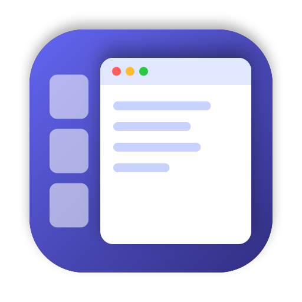

# Stage Left

A tiny macOS menu bar app for people who use **Stage Manager**. It snaps every
window you open to the stage — from the edge of the recent-apps strip on the
left to the right edge of the screen — so windows never cover the strip or
leave a gap beside it. When you connect or disconnect a display, it refits
your windows there too.

**[Download the latest version](https://github.com/AyushSaini00/stage-left-releases/releases/latest)**

Requires macOS 13 (Ventura) or later, with Stage Manager turned on
(System Settings → Desktop & Dock → Stage Manager).

## Install

1. Download **StageLeft-*.dmg** from the [latest release](https://github.com/AyushSaini00/stage-left-releases/releases/latest),
   open it, and drag **Stage Left** to Applications.
2. Open Stage Left. macOS will say it "could not verify Stage Left is free of
   malware", because the app isn't notarized by Apple. Click **Done**, then go
   to **System Settings → Privacy & Security**, scroll down, and click
   **Open Anyway** next to Stage Left.
3. When asked, turn on Stage Left in **System Settings → Privacy & Security →
   Accessibility**. It needs this to move and resize other apps' windows.
4. In Stage Left's settings, turn on **Launch at login**.

## Use

Stage Left lives in the menu bar. New windows fit themselves; you don't need
to do anything.

- **⌃⌥F** fits the current window.
- **⌃⌥⇧F** fits every window.
- **Don't Fit _App_** in the menu bar menu leaves the app you're in alone.
  System Settings, Calculator and a few other utilities are left alone by default.
- **Settings** let you set the strip width (measured automatically by default),
  extra space after the strip, and which apps to leave alone.

## Update

Quit Stage Left from its menu, download the new version, and replace the old
one in Applications. You may need to click **Open Anyway** again.

## Uninstall

Quit Stage Left from its menu, delete it from Applications, and remove it from
System Settings → Privacy & Security → Accessibility.

## Privacy

Stage Left doesn't connect to the internet or collect any data. It only reads
window positions and moves windows on your Mac.
